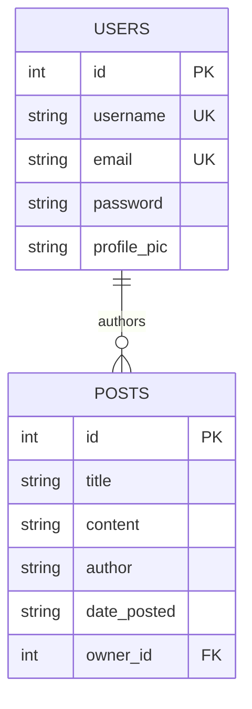

<div align="center">

# 📝 Blogging REST API
### Production-Grade RESTful API with FastAPI, SQLAlchemy, JWT Authentication & Automated Tests

[](https://blogging-api-deployment.vercel.app)
[](https://blogging-api-deployment.vercel.app/docs)
[](https://vercel.com/new/clone?repository-url=https%3A%2F%2Fgithub.com%2Froraks24%2Fblogging-api)
[](https://fastapi.tiangolo.com)
[](https://www.python.org/)
[](https://docs.pydantic.dev/)
[](https://www.sqlalchemy.org/)
[](https://jwt.io/)
[](https://pytest.org/)
[](LICENSE)

<br />

**A robust, clean, and scalable backend engine engineered with modern asynchronous Python standards. Deployed live on Vercel Serverless.**

[🌐 Live API](https://blogging-api-deployment.vercel.app) · [📑 Interactive Swagger Docs](https://blogging-api-deployment.vercel.app/docs) · [📖 ReDoc](https://blogging-api-deployment.vercel.app/redoc) · [🚀 Deploy Your Own](#-deploying-to-vercel) · [⚡ Quick Start](#-quick-start)

</div>

---

## 🌐 Production Deployment & Live API

The API is live and globally served via **Vercel Serverless Functions**:

* 🔗 **Live Base URL**: [**https://blogging-api-deployment.vercel.app**](https://blogging-api-deployment.vercel.app)
* 📑 **Interactive Swagger UI**: [**https://blogging-api-deployment.vercel.app/docs**](https://blogging-api-deployment.vercel.app/docs)
* 📖 **ReDoc Documentation**: [**https://blogging-api-deployment.vercel.app/redoc**](https://blogging-api-deployment.vercel.app/redoc)

---

## 🌟 Overview & Key Features

The **Blogging REST API** is designed as a modular, secure, and production-ready foundation for content management platforms and blogging engines:

- 🔐 **Stateless Authentication**: JSON Web Tokens (JWT) signed with HMAC-SHA256, salted password hashing via `bcrypt`, and OAuth2 password bearer schemes.
- 🗄️ **Dual Database Support**: Seamless development using local SQLite and zero-downtime transition to production PostgreSQL (e.g. Supabase, Neon, AWS RDS).
- 📰 **Complete CRUD Operations**: Full lifecycle management of blog posts with author attribution, pagination, and ownership verification.
- 🖼️ **Media & Profile Uploads**: Multi-part form handling for user avatar and asset uploads with static file delivery.
- ⚡ **Background Tasks**: Asynchronous event execution (e.g., automated welcome notifications) running out-of-band after HTTP response delivery.
- 📊 **Middleware Logging & CORS**: Configured cross-origin resource sharing and millisecond-precision request logging.
- 🧪 **Automated Test Coverage**: Comprehensive test suite utilizing `pytest` and FastAPI's `TestClient` over isolated in-memory databases.
- ☁️ **Vercel Serverless Architecture**: Fully configured with ASGI entrypoints and `vercel.json` routing for instant serverless execution.

---

## 🏗️ Database Architecture



---

## 🚀 Deploying to Vercel

The API is fully adapted for **Vercel Serverless Functions** through Python ASGI routing.

### 1-Click Deployment (Clone & Host Your Own)

[](https://vercel.com/new/clone?repository-url=https%3A%2F%2Fgithub.com%2Froraks24%2Fblogging-api)

1. Click the **Deploy with Vercel** button above.
2. Link your GitHub account and import the repository.
3. Configure the following **Environment Variables**:
   - `SECRET_KEY`: A cryptographically secure random string (e.g., `openssl rand -hex 32`).
   - `DATABASE_URL` *(Optional)*: Your cloud PostgreSQL connection URI (e.g., Supabase or Neon). If left unset, the API defaults to an ephemeral `/tmp/blog.db` SQLite database.
4. Click **Deploy**. Vercel will build and serve the application globally.

### Deploying via Vercel CLI
```bash
# Install and link Vercel CLI
npm install -g vercel

# Deploy to production
vercel --prod
```

---

## ⚡ Quick Start (Local Development)

### 1. Prerequisites
- Python 3.10+
- Git

### 2. Installation
```bash
# Clone the repository
git clone https://github.com/roraks24/blogging-api.git
cd blogging-api

# Create & activate a virtual environment
python -m venv .venv
.venv\Scripts\activate      # Windows
# source .venv/bin/activate # macOS / Linux

# Install dependencies
pip install -r requirements.txt
```

### 3. Environment Configuration
Create a `.env` file from the provided example template:
```bash
cp .env.example .env
```
Inside `.env`, define your configuration:
```env
SECRET_KEY=your_super_secret_jwt_key
DATABASE_URL=sqlite:///./blog.db
```

### 4. Run the API Server
```bash
uvicorn app.main:app --reload --host 127.0.0.1 --port 8000
```
- **API Base URL**: `http://127.0.0.1:8000`
- **Interactive Swagger UI**: [http://127.0.0.1:8000/docs](http://127.0.0.1:8000/docs)
- **Alternative ReDoc UI**: [http://127.0.0.1:8000/redoc](http://127.0.0.1:8000/redoc)

---

## 📡 API Endpoints

### Authentication & Users
| Method | Endpoint | Auth Required | Description | Request Body |
|---|---|:---:|---|---|
| `POST` | `/register` | No | Register a new user account | `{"username", "email", "password"}` |
| `POST` | `/login` | No | Authenticate user & receive bearer JWT | `OAuth2 Password Form (username, password)` |
| `POST` | `/users/{id}/upload` | Yes | Upload user profile picture | `multipart/form-data (file)` |

### Blog Posts
| Method | Endpoint | Auth Required | Description |
|---|---|:---:|---|
| `GET` | `/posts` | No | Retrieve list of all published posts |
| `GET` | `/posts/{id}` | No | Fetch detailed post by identifier |
| `POST` | `/posts` | Yes | Create a new blog post |
| `PUT` | `/posts/{id}` | Yes | Update an existing blog post |
| `DELETE` | `/posts/{id}` | Yes | Remove a blog post |

### Health & Metadata
| Method | Endpoint | Auth Required | Description |
|---|---|:---:|---|
| `GET` | `/` | No | Service status check and documentation links |

---

## 🧪 Running Automated Tests

The test suite validates status codes, model schemas, registration flows, and route security over an isolated in-memory database:

```bash
pytest -v
```

Expected output:
```text
tests/test_posts.py::test_get_posts PASSED
tests/test_posts.py::test_get_post PASSED
tests/test_posts.py::test_create_post PASSED
tests/test_posts.py::test_update_post PASSED
tests/test_posts.py::test_delete_post PASSED
tests/test_posts.py::test_register_user PASSED
tests/test_posts.py::test_login PASSED

============================== 7 passed in 1.03s ==============================
```

---

## 🐳 Docker Deployment

To run the application within an isolated container:

```bash
# Build the Docker image
docker build -t blogging-api .

# Run the container
docker run -p 8000:8000 -e SECRET_KEY="production-secret" blogging-api
```

---

## 📂 Repository Structure

```
blogging-api/
├── api/
│   └── index.py            # Vercel Serverless Python entrypoint
├── app/
│   ├── routers/
│   │   ├── posts.py        # Blog posts CRUD router
│   │   └── users.py        # Authentication & user profile router
│   ├── auth.py             # JWT issuance and token validation
│   ├── database.py         # SQLAlchemy engine & session dependency
│   ├── dependencies.py     # Reusable request dependency guards
│   ├── hashing.py          # Secure bcrypt password encryption
│   ├── main.py             # FastAPI factory, middleware & routing
│   ├── models.py           # SQLAlchemy declarative database models
│   └── schemas.py          # Pydantic v2 validation schemas
├── tests/
│   ├── __init__.py
│   ├── conftest.py
│   └── test_posts.py       # Pytest integration test suite
├── uploads/                # File uploads storage directory (.gitkeep)
├── .env.example            # Environment template configuration
├── .gitignore              # Git ignore rules for Python & binaries
├── Dockerfile              # Container configuration
├── requirements.txt        # Production Python dependencies
├── vercel.json             # Vercel serverless build & rewrite rules
└── README.md               # API documentation
```

---

## 👤 Author

Developed by **[roraks24](https://github.com/roraks24)**.
